# LARAVEL MVC FLOW GUIDE

## Tài Liệu Hướng Dẫn Học Tập Laravel MVC — Dự Án Quản Lý Sinh Viên

> **Phiên bản Laravel:** 13.x (Laravel Framework ^13.17, PHP ^8.3)  
> **Đối tượng:** Sinh viên năm 3 CNTT đã học PHP cơ bản  
> **Ngôn ngữ:** Tiếng Việt  
> **Ngày tạo:** 2026-10-26

---

## MỤC LỤC

- [PHẦN I — LÝ THUYẾT LARAVEL MVC TỪ ĐẦU](#phần-i--lý-thuyết-laravel-mvc-từ-đầu)
    - [1. MVC là gì?](#1-mvc-là-gì)
    - [2. Luồng xử lý tổng quát của Laravel](#2-luồng-xử-lý-tổng-quát-của-laravel)
    - [3. Giải thích từng thành phần](#3-giải-thích-từng-thành-phần-trong-kiến-trúc)
        - [3.1 Routing](#31-routing)
        - [3.2 Middleware](#32-middleware)
        - [3.3 Controller](#33-controller)
        - [3.4 Model và Eloquent ORM](#34-model-và-eloquent-orm)
        - [3.5 View và Blade](#35-view-và-blade)
        - [3.6 Database, Migration và Seeding](#36-database-migration-và-seeding)
        - [3.7 Phân biệt các thành phần dễ nhầm lẫn](#37-phân-biệt-các-thành-phần-dễ-nhầm-lẫn)
- [PHẦN II — PHÂN TÍCH CẤU TRÚC DỰ ÁN THỰC TẾ](#phần-ii--phân-tích-cấu-trúc-dự-án-thực-tế)
    - [1. Sơ đồ cấu trúc dự án](#1-sơ-đồ-cấu-trúc-dự-án)
    - [2. Phân tích quan hệ dữ liệu](#2-phân-tích-quan-hệ-dữ-liệu)
    - [3. Phân tích routes/web.php](#3-phân-tích-routeswebphp)
- [PHẦN III — PHÂN TÍCH LUỒNG XỬ LÝ TỪNG CHỨC NĂNG](#phần-iii--phân-tích-luồng-xử-lý-từng-chức-năng)
    - [Chức năng 1: Trang chủ](#chức-năng-1-hiển-thị-trang-chủ)
    - [Chức năng 2: Danh sách sinh viên](#chức-năng-2-xem-danh-sách-sinh-viên)
    - [Chức năng 3: Form thêm sinh viên](#chức-năng-3-hiển-thị-biểu-mẫu-thêm-sinh-viên)
    - [Chức năng 4: Xử lý thêm sinh viên](#chức-năng-4-xử-lý-thêm-sinh-viên)
    - [Chức năng 5: Xem chi tiết sinh viên](#chức-năng-5-xem-chi-tiết-sinh-viên)
    - [Chức năng 6: Form sửa sinh viên](#chức-năng-6-hiển-thị-biểu-mẫu-sửa-sinh-viên)
    - [Chức năng 7: Cập nhật sinh viên](#chức-năng-7-cập-nhật-sinh-viên)
    - [Chức năng 8: Xóa sinh viên](#chức-năng-8-xóa-sinh-viên)
- [PHẦN IV — TỔNG HỢP BẰNG SƠ ĐỒ](#phần-iv--tổng-hợp-bằng-sơ-đồ)
- [PHẦN V — ĐỐI CHIẾU LÝ THUYẾT VỚI MÃ NGUỒN](#phần-v--đối-chiếu-lý-thuyết-với-mã-nguồn)
- [PHẦN VI — NHẬN XÉT CODE VÀ CÁC ĐIỂM CẦN CHÚ Ý](#phần-vi--nhận-xét-code-và-các-điểm-cần-chú-ý)
- [PHẦN VII — TÀI LIỆU ÔN TẬP VÀ CHUẨN BỊ BẢO VỆ](#phần-vii--tài-liệu-ôn-tập-và-chuẩn-bị-bảo-vệ)

---

# PHẦN I — LÝ THUYẾT LARAVEL MVC TỪ ĐẦU

## 1. MVC là gì?

### 1.1 Định nghĩa

**MVC** là viết tắt của:

- **M** — **Model** (Mô hình dữ liệu)
- **V** — **View** (Giao diện người dùng)
- **C** — **Controller** (Bộ điều khiển)

MVC là một **mẫu kiến trúc phần mềm** (architectural pattern) giúp tổ chức mã nguồn theo từng trách nhiệm rõ ràng, thay vì nhét tất cả vào một file duy nhất.

### 1.2 Tại sao phải tách thành M, V, C?

Hãy tưởng tượng không dùng MVC — bạn viết một file PHP như sau:

```php
// KHÔNG DÙNG MVC — một file làm tất cả (xấu)
<?php
$conn = new PDO("mysql:host=localhost;dbname=qlsv", "root", "");
$result = $conn->query("SELECT * FROM students");
echo "<html><body><table>";
foreach ($result as $row) {
    echo "<tr><td>" . $row['StudentName'] . "</td></tr>";
}
echo "</table></body></html>";
?>
```

**Vấn đề:**

- Truy vấn SQL lẫn lộn với HTML.
- Nếu đổi cấu trúc bảng, phải sửa khắp file.
- Không thể tái sử dụng, không thể test riêng từng phần.
- Bảo mật kém (SQL injection dễ xảy ra).
- Khó bảo trì khi dự án lớn.

### 1.3 Vai trò, trách nhiệm và giới hạn từng thành phần

| Thành phần     | Vai trò            | Trách nhiệm                                       | KHÔNG được làm                                      |
| -------------- | ------------------ | ------------------------------------------------- | --------------------------------------------------- |
| **Model**      | Đại diện dữ liệu   | Tương tác với database, định nghĩa quan hệ        | Xây dựng HTML, xử lý request HTTP                   |
| **View**       | Hiển thị giao diện | Nhận dữ liệu từ Controller, render HTML           | Truy vấn database trực tiếp, xử lý nghiệp vụ        |
| **Controller** | Điều phối luồng    | Nhận request, gọi Model lấy dữ liệu, gửi cho View | Chứa quá nhiều logic nghiệp vụ, không nên viết HTML |

### 1.4 Quan hệ giữa ba thành phần

```
Người dùng → [Request] → Controller → Model → Database
                                ↓
Người dùng ← [Response] ← View ← Controller ← Model ← Database
```

**Ví dụ với chức năng xem danh sách sinh viên:**

- **Controller** nhận request `GET /students`, gọi `Student::paginate(10)`.
- **Model** `Student` truy vấn bảng `students` trong database, trả về danh sách.
- **Controller** gửi danh sách đó vào **View** `students/index.blade.php`.
- **View** dùng vòng lặp `@foreach` hiển thị từng dòng sinh viên.

### 1.5 MVC không đơn giản chỉ là ba file

MVC là **cách tổ chức trách nhiệm**, không phải chỉ là tạo ba file tên Model, View, Controller. Nguyên tắc cốt lõi là **Separation of Concerns** (tách biệt mối quan tâm):

- Ai quan tâm đến **dữ liệu**? → Model.
- Ai quan tâm đến **cách hiển thị**? → View.
- Ai quan tâm đến **luồng xử lý**? → Controller.

---

## 2. Luồng xử lý tổng quát của Laravel

> **Lưu ý phiên bản:** Dự án dùng Laravel 13.x. Phiên bản này dùng cấu trúc `bootstrap/app.php` mới thay cho `Http/Kernel.php` cũ (bị bỏ từ Laravel 11+). Không có class `Kernel` riêng biệt nữa.

### 2.1 Điểm khởi đầu: `public/index.php`

Mọi request HTTP đều bắt đầu tại `public/index.php`. File này:

1. Nạp Composer autoloader (`vendor/autoload.php`).
2. Nạp `bootstrap/app.php` để tạo instance của ứng dụng Laravel.
3. Gọi `$app->handleRequest(Request::capture())` để xử lý request.

### 2.2 `bootstrap/app.php` — Cấu hình ứng dụng (Laravel 13)

```php
// bootstrap/app.php — thực tế của dự án
return Application::configure(basePath: dirname(__DIR__))
    ->withRouting(
        web: __DIR__.'/../routes/web.php',   // nạp file route web
        commands: __DIR__.'/../routes/console.php',
        health: '/up',
    )
    ->withMiddleware(function (Middleware $middleware): void {
        // Middleware tùy chỉnh được đăng ký ở đây (hiện để trống)
    })
    ->withExceptions(function (Exceptions $exceptions): void {
        $exceptions->shouldRenderJsonWhen(
            fn (Request $request) => $request->is('api/*') || $request->expectsJson(),
        );
    })->create();
```

Đây là điểm khác biệt quan trọng so với Laravel 10 trở về trước: không có `app/Http/Kernel.php`.

### 2.3 Luồng đầy đủ từ Request đến Response

```
1. Trình duyệt gửi HTTP Request (VD: GET /students)
        ↓
2. public/index.php — điểm vào duy nhất
        ↓
3. bootstrap/app.php — khởi tạo Application, đăng ký service providers
        ↓
4. HTTP Pipeline — xử lý qua các middleware toàn cục
   (VD: session, CSRF, encryption cookies...)
        ↓
5. Router (routes/web.php) — đối chiếu URL + HTTP method với route đã khai báo
        ↓
6. Route middleware — chạy middleware của route cụ thể (nếu có)
        ↓
7. Controller method được gọi (VD: StudentController@index)
        ↓
8. Controller gọi Model/DB để lấy hoặc lưu dữ liệu
        ↓
9. Database trả kết quả về Model/DB
        ↓
10. Controller tạo Response: view() / redirect() / json()
        ↓
11. Response đi ngược qua middleware pipeline
        ↓
12. HTTP Response gửi về trình duyệt
        ↓
13. Trình duyệt render HTML
```

### 2.4 Hai luồng chính

#### Luồng ĐỌC (GET — hiển thị giao diện)

```
GET /students
  → Router khớp route
  → StudentController@index()
  → Student::paginate(10) [truy vấn DB]
  → return view('students.index', ['students' => $students])
  → Blade render HTML
  → Response 200 OK với HTML
```

#### Luồng GHI (POST/PUT/PATCH/DELETE — thay đổi dữ liệu)

```
POST /students [form submit]
  → Router khớp route
  → Middleware xác minh CSRF token
  → StudentController@store(Request $request)
  → $request->validate([...]) — xác thực dữ liệu
      ├── Thất bại → redirect về form, flash lỗi vào session
      └── Thành công → DB::table('students')->insert([...])
                         → redirect()->route('students.index')
                              ->with('success', 'Thêm thành công')
```

### 2.5 Trường hợp đặc biệt

**Validation thất bại:**

- Laravel tự động redirect về trang trước (form).
- Dữ liệu cũ được lưu vào session (dùng `old('field')` trong View).
- Lỗi được đưa vào `$errors` bag, View dùng `$errors->any()` để hiển thị.

**Redirect sau ghi dữ liệu:**

- Sau INSERT/UPDATE/DELETE, Controller redirect về trang danh sách.
- Dữ liệu thông báo (flash message) được lưu vào session 1 lần.
- Trang danh sách đọc thông báo từ session và xóa nó đi.

**Lỗi HTTP:**

- Route không khớp → 404 Not Found.
- CSRF token sai/hết hạn → 419 Page Expired.
- Server lỗi → 500 Internal Server Error.

---

## 3. Giải thích từng thành phần trong kiến trúc

### 3.1 Routing

#### Route là gì và tại sao cần khai báo?

**Route** là bản đồ ánh xạ: khi người dùng truy cập **URL X bằng HTTP method Y**, Laravel sẽ thực thi **đoạn code Z**.

Nếu không khai báo route, Laravel không biết phải làm gì với request đó → trả về 404.

#### HTTP Methods khác nhau như thế nào?

| Method   | Mục đích                  | Ví dụ trong QLSV                |
| -------- | ------------------------- | ------------------------------- |
| `GET`    | Đọc, hiển thị dữ liệu     | Xem danh sách, mở form          |
| `POST`   | Tạo mới dữ liệu           | Thêm sinh viên mới              |
| `PUT`    | Cập nhật toàn bộ bản ghi  | Sửa toàn bộ thông tin sinh viên |
| `PATCH`  | Cập nhật một phần bản ghi | Sửa một vài trường              |
| `DELETE` | Xóa bản ghi               | Xóa sinh viên                   |

> **Lưu ý:** HTML form chỉ hỗ trợ GET và POST. Để dùng PUT/PATCH/DELETE, Laravel dùng `@method('PUT')` — tạo hidden input `_method` để Laravel nhận diện.

#### `routes/web.php` có vai trò gì?

File này chứa tất cả các route cho giao diện web. Laravel nạp file này từ `bootstrap/app.php`. Mọi URL mà người dùng trình duyệt có thể truy cập đều phải được khai báo ở đây.

#### Route name và lợi ích của `route('...')`

```php
// Khai báo route có tên
Route::get('/students', [StudentController::class, 'index'])->name('students.index');

// Dùng route name trong code
return redirect()->route('students.index');   // trong Controller
// href="{{ route('students.index') }}"       // trong Blade
```

**Lợi ích:** Nếu đổi URL từ `/students` sang `/sinhvien`, chỉ cần sửa một chỗ trong `web.php`. Mọi chỗ dùng `route('students.index')` vẫn hoạt động đúng.

#### `Route::resource()` hoạt động như thế nào?

Một dòng khai báo `Route::resource('students', StudentController::class)` tự động sinh ra **7 route tiêu chuẩn**:

| HTTP Method | URI                        | Route Name         | Controller Method | Mục đích          |
| ----------- | -------------------------- | ------------------ | ----------------- | ----------------- |
| GET         | `/students`                | `students.index`   | `index()`         | Danh sách         |
| GET         | `/students/create`         | `students.create`  | `create()`        | Mở form thêm      |
| POST        | `/students`                | `students.store`   | `store()`         | Lưu sinh viên mới |
| GET         | `/students/{student}`      | `students.show`    | `show()`          | Xem chi tiết      |
| GET         | `/students/{student}/edit` | `students.edit`    | `edit()`          | Mở form sửa       |
| PUT/PATCH   | `/students/{student}`      | `students.update`  | `update()`        | Cập nhật          |
| DELETE      | `/students/{student}`      | `students.destroy` | `destroy()`       | Xóa               |

> Để xem danh sách route thực tế, chạy: `php artisan route:list`

---

### 3.2 Middleware

#### Middleware là gì?

**Middleware** là lớp xử lý nằm **giữa** request từ trình duyệt và Controller. Mỗi request phải đi qua middleware trước khi vào Controller.

```
Request → [Middleware 1] → [Middleware 2] → Controller → Response
```

#### Middleware có thể làm gì?

- **Xác thực** (Authentication): Kiểm tra người dùng đã đăng nhập chưa.
- **Phân quyền** (Authorization): Kiểm tra người dùng có quyền làm việc này không.
- **CSRF Protection**: Xác minh token để ngăn tấn công giả mạo.
- **Logging**: Ghi lại mọi request.
- **Nén dữ liệu**, **xử lý CORS**, v.v.

#### Middleware trong dự án QLSV

Nhìn vào `bootstrap/app.php`:

```php
->withMiddleware(function (Middleware $middleware): void {
    // Để trống — không có middleware tùy chỉnh
})
```

Dự án **không khai báo middleware tùy chỉnh nào**. Tuy nhiên, Laravel vẫn tự động áp dụng middleware mặc định (session, CSRF protection, cookie encryption...) thông qua cơ chế nội tại của framework.

> **Nhận xét:** Dự án hiện tại **không có middleware xác thực đăng nhập**. Bất kỳ ai cũng có thể truy cập, thêm, sửa, xóa sinh viên mà không cần đăng nhập.

#### Phân biệt Middleware với Controller và Validation

|             | Middleware                       | Controller                | Validation                         |
| ----------- | -------------------------------- | ------------------------- | ---------------------------------- |
| **Vị trí**  | Trước Controller                 | Trong Controller          | Trong Controller                   |
| **Câu hỏi** | "Request này có được vào không?" | "Làm gì với request này?" | "Dữ liệu có đúng định dạng không?" |
| **Ví dụ**   | Đã đăng nhập chưa?               | Lấy dữ liệu sinh viên     | Email có đúng format không?        |

---

### 3.3 Controller

#### Controller là gì?

Controller là class PHP nằm trong `app/Http/Controllers/`. Nó đóng vai trò **bộ điều phối** — nhận request, gọi Model lấy dữ liệu, gửi dữ liệu cho View, trả response.

#### Tại sao không đặt HTML vào Controller?

```php
// SAI — đặt HTML trong Controller
public function index() {
    $students = Student::all();
    echo "<html><table>";
    foreach ($students as $s) { echo "<tr><td>{$s->StudentName}</td></tr>"; }
    echo "</table></html>";
}

// ĐÚNG — Controller chỉ điều phối
public function index() {
    return view('students.index', ['students' => Student::paginate(10)]);
}
```

#### Các kiểu trả kết quả

```php
// 1. Trả về View
return view('students.index', ['students' => $students]);

// 2. Redirect kèm flash message
return redirect()->route('students.index')->with('success', 'Thêm thành công');

// 3. JSON — dành cho API
return response()->json(['data' => $students]);
```

**Khi nào dùng gì?**

- `return view()`: Khi cần hiển thị giao diện (GET request đọc dữ liệu).
- `return redirect()`: Sau khi xử lý ghi dữ liệu (POST/PUT/DELETE) để tránh form resubmit.
- `return response()->json()`: Khi làm API, trả JSON cho frontend.

---

### 3.4 Model và Eloquent ORM

#### Model là gì?

**Model** là class PHP đại diện cho một bảng trong database. Mỗi instance của Model tương ứng với một **hàng (row)** trong bảng đó.

```php
// app/Models/Student.php — đại diện cho bảng 'students'
class Student extends Model { ... }

$student = Student::find(1);  // Lấy sinh viên có StudentID = 1
echo $student->StudentName;   // Truy cập cột StudentName
```

#### Eloquent ORM là gì?

**ORM** = Object-Relational Mapping — ánh xạ giữa Object (PHP) và Relation (bảng SQL).

**Eloquent** là ORM tích hợp sẵn trong Laravel. Nó cho phép bạn làm việc với database bằng PHP thuần mà không cần viết SQL thủ công.

```php
// Eloquent ORM — dùng class/method PHP
Student::all();                    // SELECT * FROM students
Student::paginate(10);             // SELECT * FROM students LIMIT 10
Student::find(1);                  // SELECT * FROM students WHERE StudentID = 1
$student->update([...]);           // UPDATE students SET ... WHERE StudentID = ?
$student->delete();                // DELETE FROM students WHERE StudentID = ?
```

#### Quy ước của Eloquent

| Quy ước    | Mặc định                        | Dự án QLSV  | Cần khai báo lại? |
| ---------- | ------------------------------- | ----------- | ----------------- |
| Tên bảng   | `students` (plural, snake_case) | `students`  | Không             |
| Khóa chính | `id`                            | `StudentID` | **Có**            |
| Timestamps | `created_at`, `updated_at`      | Không có    | **Có**            |

```php
// app/Models/Student.php
class Student extends Model {
    public $timestamps = false;           // Bảng không có created_at, updated_at
    protected $primaryKey = 'StudentID'; // Khóa chính không phải 'id'
}
```

#### `$fillable` có vai trò gì?

`$fillable` là danh sách các cột **được phép ghi** thông qua mass assignment. Đây là cơ chế bảo mật ngăn người dùng gửi lên các trường không mong muốn.

```php
protected $fillable = ['StudentID', 'StudentName', 'StudentEmail', 'StudentGender', 'ClassRoomID'];

// Chỉ các cột trong $fillable mới được ghi
$student->update($request->only(['StudentName', 'StudentEmail', ...]));
```

#### `belongsTo()` — Quan hệ Eloquent

```php
// Student belongsTo Classroom
public function classroom() {
    return $this->belongsTo(Classroom::class, 'ClassRoomID', 'ClassRoomID');
    //                                          ^FK trong students  ^PK trong classrooms
}

// Sử dụng quan hệ
$student->classroom->ClassRoomName;  // Lấy tên lớp của sinh viên
```

#### Eloquent ORM vs. Query Builder vs. SQL trực tiếp

|                                | Eloquent ORM                | Query Builder                  | SQL Trực tiếp        |
| ------------------------------ | --------------------------- | ------------------------------ | -------------------- |
| **Cú pháp**                    | `Student::all()`            | `DB::table('students')->get()` | `DB::statement(...)` |
| **Trả về**                     | Collection of Model objects | Collection of stdClass         | Kết quả thô          |
| **Quan hệ**                    | Có (belongsTo, hasMany...)  | Không                          | Không                |
| **Mass assignment protection** | Có ($fillable)              | Không                          | Không                |
| **Dùng khi**                   | Phần lớn thao tác CRUD      | Query phức tạp                 | Hiếm dùng            |

---

### 3.5 View và Blade

#### Blade là gì?

**Blade** là template engine của Laravel. File Blade có đuôi `.blade.php`. `{{ ... }}` tự động escape HTML (ngăn XSS). `{!! ... !!}` xuất ra không escape.

```blade
{{-- Blade tương đương PHP thuần --}}
@foreach($students as $row)
    {{ $row->StudentName }}
@endforeach
```

#### Cách truyền dữ liệu từ Controller sang View

```php
// Cách 1: Mảng kết hợp
return view('students.index', ['students' => Student::paginate(10)]);

// Cách 2: compact() — tạo mảng từ tên biến
$classrooms = Classroom::all();
$student = Student::find(1);
return view('students.edit', compact('classrooms', 'student'));
// Tương đương: ['classrooms' => $classrooms, 'student' => $student]
```

#### Blade Template Inheritance

```blade
{{-- master.blade.php — layout chung --}}
<!DOCTYPE html>
<html>
<body>
    <div class="container">
        @yield('content')    {{-- Chỗ trống để view con điền vào --}}
    </div>
</body>
</html>

{{-- index.blade.php — view con --}}
@extends('students.master')   {{-- Kế thừa master layout --}}

@section('content')           {{-- Điền vào chỗ trống 'content' --}}
    <h1>Danh sách sinh viên</h1>
    ...
@endsection
```

#### Vai trò của `@csrf` và `@method`

```blade
{{-- Form thêm mới (POST) --}}
<form method="post" action="{{ route('students.store') }}">
    @csrf     {{-- Tạo: <input type="hidden" name="_token" value="..."> --}}
    ...
</form>

{{-- Form cập nhật (PUT) --}}
<form method="post" action="{{ route('students.update', $student->StudentID) }}">
    @csrf
    @method('PUT')   {{-- Tạo: <input type="hidden" name="_method" value="PUT"> --}}
    ...
</form>
```

**Tại sao cần `@csrf`?**  
Ngăn tấn công CSRF. Nếu thiếu → HTTP 419 error.

**Tại sao cần `@method('PUT')`?**  
HTML chỉ hỗ trợ GET và POST. Laravel đọc hidden field `_method` để biết đây là PUT/PATCH/DELETE.

---

### 3.6 Database, Migration và Seeding

#### Migration là gì?

**Migration** = Phiên bản hóa cấu trúc database bằng code PHP.

```php
Schema::create('classrooms', function (Blueprint $table) {
    $table->integerIncrements('ClassRoomID');
    $table->string('ClassRoomName');
});
// php artisan migrate
```

#### Seeding là gì?

**Seeder** tạo **dữ liệu mẫu** (không phải cấu trúc bảng như Migration).

|              | Migration                     | Seeder                    |
| ------------ | ----------------------------- | ------------------------- |
| **Làm gì**   | Tạo/sửa/xóa **cấu trúc** bảng | Chèn **dữ liệu** vào bảng |
| **Chạy khi** | Tạo mới/thay đổi cấu trúc DB  | Khởi tạo dữ liệu mẫu/test |
| **Lệnh**     | `php artisan migrate`         | `php artisan db:seed`     |

---

### 3.7 Phân biệt các thành phần dễ nhầm lẫn

| Cặp                                 | Khác nhau ở điểm nào                                                         | Ví dụ trong QLSV                                                        |
| ----------------------------------- | ---------------------------------------------------------------------------- | ----------------------------------------------------------------------- |
| **Route vs Controller**             | Route: khai báo URL nào → code nào. Controller: code xử lý thực sự           | Route: `Route::resource(...)` → Controller: `StudentController@index()` |
| **Controller vs Model**             | Controller: điều phối luồng. Model: tương tác DB                             | Controller gọi `Student::paginate(10)`, Model thực hiện truy vấn SQL    |
| **Model vs Query Builder**          | Model: class Eloquent có quan hệ. QB: fluent interface SQL thuần             | `Student::paginate(10)` vs `DB::table('students')->paginate(10)`        |
| **Model vs Migration**              | Model: làm việc với dữ liệu lúc runtime. Migration: định nghĩa cấu trúc bảng | `Student.php` vs `2026_10_08_062413_create_students_table.php`          |
| **View vs Blade**                   | View: file template nói chung. Blade: ngôn ngữ template của Laravel          | Tất cả file `.blade.php` trong `resources/views/`                       |
| **Validation vs Middleware**        | Middleware: chặn/cho phép request. Validation: kiểm tra dữ liệu              | Validation trong `store()`, không có middleware tùy chỉnh               |
| **`return view()` vs `redirect()`** | `view()`: render HTML. `redirect()`: bảo trình duyệt gửi request mới         | `index()` dùng `view()`. `store()` dùng `redirect()`                    |
| **HTTP Request vs Response**        | Request: trình duyệt gửi lên. Response: Laravel gửi lại                      | `$request->input('StudentName')` vs `return view(...)`                  |

---

# PHẦN II — PHÂN TÍCH CẤU TRÚC DỰ ÁN THỰC TẾ

## 1. Sơ đồ cấu trúc dự án

### Cây thư mục (chỉ các phần liên quan đến luồng xử lý)

```
projectQLSV/
├── bootstrap/
│   └── app.php                          ← Điểm khởi tạo ứng dụng Laravel 13
├── routes/
│   └── web.php                          ← Khai báo tất cả route web
├── app/
│   ├── Http/
│   │   └── Controllers/
│   │       └── StudentController.php    ← Bộ điều khiển quản lý sinh viên
│   └── Models/
│       ├── Student.php                  ← Model sinh viên (bảng students)
│       └── Classroom.php               ← Model lớp học (bảng classrooms)
├── resources/
│   └── views/
│       ├── welcome.blade.php            ← Trang chủ
│       └── students/
│           ├── master.blade.php         ← Layout chung cho module sinh viên
│           ├── index.blade.php          ← Danh sách sinh viên
│           ├── create.blade.php         ← Form thêm sinh viên
│           ├── edit.blade.php           ← Form sửa sinh viên
│           └── show.blade.php          ← Xem chi tiết sinh viên
└── database/
    ├── migrations/
    │   ├── 2026_10_08_061129_create_classrooms_table.php
    │   └── 2026_10_08_062413_create_students_table.php
    └── seeders/
        ├── DatabaseSeeder.php
        └── StudentSeeder.php
```

### Bảng ánh xạ thành phần

| Thành phần           | File thực tế                                                        | Vai trò trong dự án                                                                              |
| -------------------- | ------------------------------------------------------------------- | ------------------------------------------------------------------------------------------------ |
| Routing              | `routes/web.php`                                                    | Khai báo 1 route trang chủ và 7 resource routes cho sinh viên                                    |
| Controller           | `app/Http/Controllers/StudentController.php`                        | Xử lý 7 actions CRUD: index, create, store, show, edit, update, destroy                          |
| Model (Sinh viên)    | `app/Models/Student.php`                                            | Đại diện bảng `students`, khai báo PK `StudentID`, tắt timestamps, quan hệ `belongsTo` Classroom |
| Model (Lớp)          | `app/Models/Classroom.php`                                          | Đại diện bảng `classrooms`, dùng mặc định của Eloquent                                           |
| Layout               | `resources/views/students/master.blade.php`                         | Bố cục HTML chung: doctype, head, Bootstrap CSS, container                                       |
| View danh sách       | `resources/views/students/index.blade.php`                          | Bảng sinh viên, phân trang, nút thêm/sửa/xóa/chi tiết, flash message                             |
| View thêm            | `resources/views/students/create.blade.php`                         | Form nhập thông tin sinh viên mới, dropdown lớp, hiển thị lỗi                                    |
| View sửa             | `resources/views/students/edit.blade.php`                           | Form sửa thông tin, điền sẵn dữ liệu cũ, dropdown lớp                                            |
| View chi tiết        | `resources/views/students/show.blade.php`                           | Hiển thị tên, email, giới tính sinh viên                                                         |
| Trang chủ            | `resources/views/welcome.blade.php`                                 | Trang mặc định Laravel, không có link đến QLSV                                                   |
| Migration classrooms | `database/migrations/2026_10_08_061129_create_classrooms_table.php` | Tạo bảng `classrooms` với 2 cột                                                                  |
| Migration students   | `database/migrations/2026_10_08_062413_create_students_table.php`   | Tạo bảng `students` với 5 cột và FK                                                              |
| Seeder               | `database/seeders/StudentSeeder.php`                                | Chèn 5 sinh viên mẫu vào bảng                                                                    |
| Bootstrap            | `bootstrap/app.php`                                                 | Cấu hình ứng dụng Laravel 13, đăng ký route và middleware                                        |

---

## 2. Phân tích quan hệ dữ liệu

### 2.1 Cấu trúc bảng `classrooms`

Từ file `2026_10_08_061129_create_classrooms_table.php`:

| Cột             | Kiểu         | Ràng buộc                   |
| --------------- | ------------ | --------------------------- |
| `ClassRoomID`   | unsigned int | Primary Key, Auto-increment |
| `ClassRoomName` | varchar      | Not null                    |

### 2.2 Cấu trúc bảng `students`

Từ file `2026_10_08_062413_create_students_table.php`:

```php
Schema::create('students', function (Blueprint $table) {
    $table->integerIncrements('StudentID');
    $table->string('StudentName');
    $table->string('StudentEmail');
    $table->enum('StudentGender', ['0', '1']);     // 0=Nam, 1=Nữ
    $table->unsignedInteger('ClassRoomID');
    $table->foreign('ClassRoomID')
          ->references('ClassRoomID')
          ->on('ClassRooms')                        // ⚠️ Case: 'ClassRooms' vs 'classrooms'
          ->onDelete('cascade');
});
```

| Cột             | Kiểu          | Ràng buộc                            |
| --------------- | ------------- | ------------------------------------ |
| `StudentID`     | unsigned int  | Primary Key, Auto-increment          |
| `StudentName`   | varchar       | Not null                             |
| `StudentEmail`  | varchar       | Not null                             |
| `StudentGender` | enum('0','1') | Not null (0=Nam, 1=Nữ)               |
| `ClassRoomID`   | unsigned int  | Foreign Key → classrooms.ClassRoomID |

### 2.3 Quan hệ trong Model

```php
// app/Models/Student.php
public function classroom() {
    return $this->belongsTo(Classroom::class, 'ClassRoomID', 'ClassRoomID');
    //           ↑ kiểu quan hệ    ↑ Model liên kết   ↑ FK        ↑ PK bên kia
}
```

Khi gọi `$student->classroom->ClassRoomName`, Eloquent thực hiện:

```sql
SELECT * FROM classrooms WHERE ClassRoomID = [giá trị ClassRoomID của student]
```

### 2.4 Sơ đồ ERD

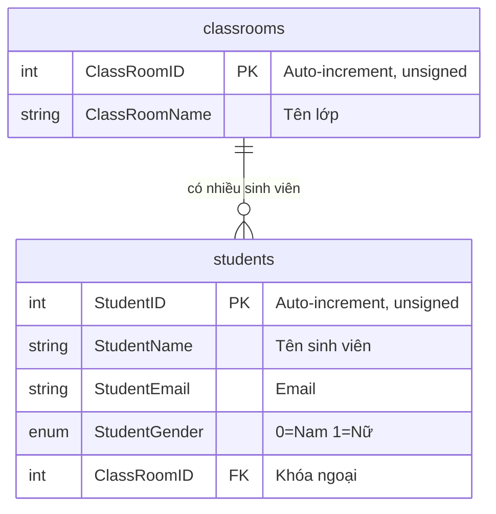

---

## 3. Phân tích `routes/web.php`

```php
<?php
// routes/web.php — toàn bộ file

use Illuminate\Support\Facades\Route;
use App\Http\Controllers\StudentController;

Route::get('/', function () {
    return view('welcome');
});

Route::resource('students', StudentController::class);
```

### 3.1 Route trang chủ `/`

- **URL:** `/`
- **HTTP Method:** GET
- **Xử lý:** Closure function (không qua Controller).
- **Kết quả:** Trả về view `welcome` → render `resources/views/welcome.blade.php`.
- **Không đi qua Controller** — đây là cách Laravel cho phép dùng closure trực tiếp trong route.

### 3.2 Bảy route sinh ra từ `Route::resource`

| HTTP Method | URI                        | Route Name         | Controller Method |
| ----------- | -------------------------- | ------------------ | ----------------- |
| GET         | `/students`                | `students.index`   | `index()`         |
| GET         | `/students/create`         | `students.create`  | `create()`        |
| POST        | `/students`                | `students.store`   | `store()`         |
| GET         | `/students/{student}`      | `students.show`    | `show()`          |
| GET         | `/students/{student}/edit` | `students.edit`    | `edit()`          |
| PUT/PATCH   | `/students/{student}`      | `students.update`  | `update()`        |
| DELETE      | `/students/{student}`      | `students.destroy` | `destroy()`       |

### 3.3 Tại sao trang chủ không đi qua `StudentController@index`?

Trang chủ và module sinh viên là hai chức năng khác nhau. `welcome.blade.php` là template giới thiệu mặc định của Laravel.

> **Nhận xét:** `welcome.blade.php` **không có link điều hướng đến `/students`**. Người dùng phải gõ URL trực tiếp để vào trang quản lý sinh viên.

---

# PHẦN III — PHÂN TÍCH LUỒNG XỬ LÝ TỪNG CHỨC NĂNG

---

## Chức năng 1: Hiển thị trang chủ

| Thuộc tính      | Giá trị                             |
| --------------- | ----------------------------------- |
| **Mục đích**    | Hiển thị trang chào mừng mặc định   |
| **HTTP Method** | GET                                 |
| **URL**         | `/`                                 |
| **Route name**  | Không đặt tên                       |
| **Controller**  | Không có — dùng closure             |
| **Truy vấn DB** | Không có                            |
| **View**        | `resources/views/welcome.blade.php` |

### Phân tích

```php
Route::get('/', function () {
    return view('welcome');   // Không có dữ liệu truyền vào
});
```

`welcome.blade.php` là file HTML lớn (224 dòng), chứa CSS Tailwind inline. Không sử dụng layout `master.blade.php` của module sinh viên. **Không có link điều hướng đến `/students`**.

### Sơ đồ luồng trang chủ

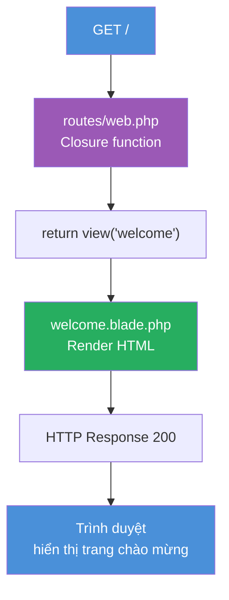

**Đọc sơ đồ:** Request đi từ trình duyệt → router → closure (không qua Controller) → view được render → response về trình duyệt.

---

## Chức năng 2: Xem danh sách sinh viên

| Thuộc tính            | Giá trị                                            |
| --------------------- | -------------------------------------------------- |
| **Mục đích**          | Hiển thị danh sách tất cả sinh viên, có phân trang |
| **HTTP Method**       | GET                                                |
| **URL**               | `/students`                                        |
| **Route name**        | `students.index`                                   |
| **Controller method** | `StudentController@index()`                        |
| **Truy vấn DB**       | `Student::paginate(10)`                            |
| **View**              | `resources/views/students/index.blade.php`         |

### Phân tích code

#### Controller: `index()`

```php
// StudentController.php — dòng 17-20
public function index()
{
    return view('students.index', ['students' => Student::paginate(10)]);
}
```

**`Student::paginate(10)` làm gì?**

- Thực hiện hai truy vấn SQL: đếm tổng số bản ghi + lấy 10 bản ghi theo trang.
- Trả về `LengthAwarePaginator` — chứa dữ liệu và thông tin phân trang.
- Tham số `?page=2` trong URL tự động được đọc.

#### View: `index.blade.php`

```blade
{{-- Hiển thị flash message --}}
@if($message = Session::get('success'))
    <div class="alert alert-success"><p>{{ $message }}</p></div>
@endif

{{-- Vòng lặp hiển thị sinh viên --}}
@foreach($students as $row)
    <tr>
        <td>{{ $row->StudentID }}</td>
        <td>{{ $row->StudentName }}</td>
        <td>{{ $row->StudentEmail }}</td>
        <td>@if($row->StudentGender == '0') Nam @else Nữ @endif</td>
        <td>{{ $row->classroom->ClassRoomName }}</td>  {{-- Lazy loading --}}
        <td>
            <form method="post" action="{{ route('students.destroy', $row->StudentID) }}">
                @csrf
                @method('DELETE')
                <a href="{{ route('students.show', $row->StudentID) }}">Xem chi tiết</a>
                <a href="{{ route('students.edit', $row->StudentID) }}">Sửa</a>
                <input type="submit" value="Xóa"/>
            </form>
        </td>
    </tr>
@endforeach

{!! $students->links() !!}  {{-- {!! !!} vì HTML không cần escape --}}
```

#### Cách lấy tên lớp: `$row->classroom->ClassRoomName`

Khi truy cập `$row->classroom`, Eloquent thực hiện **Lazy Loading**: chạy thêm một truy vấn `SELECT * FROM classrooms WHERE ClassRoomID = ?` cho mỗi sinh viên.

> **Vấn đề N+1:** 10 sinh viên = 1 truy vấn lấy danh sách + 10 truy vấn lấy lớp = 11 truy vấn. Cần Eager Loading để tối ưu.

> **Rủi ro null:** Nếu `ClassRoomID` không tồn tại trong `classrooms`, `$row->classroom` = `null` → `null->ClassRoomName` gây lỗi PHP fatal error.

### Sơ đồ luồng xem danh sách

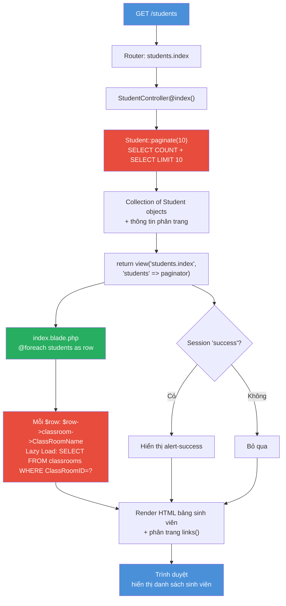

**Đọc sơ đồ:** Sau khi Eloquent lấy danh sách, với mỗi sinh viên View lại thực hiện thêm truy vấn lấy lớp (Lazy Loading). Thông báo session được đọc và hiển thị nếu có.

---

## Chức năng 3: Hiển thị biểu mẫu thêm sinh viên

| Thuộc tính            | Giá trị                                                  |
| --------------------- | -------------------------------------------------------- |
| **Mục đích**          | Hiển thị form để người dùng nhập thông tin sinh viên mới |
| **HTTP Method**       | GET                                                      |
| **URL**               | `/students/create`                                       |
| **Route name**        | `students.create`                                        |
| **Controller method** | `StudentController@create()`                             |
| **Truy vấn DB**       | `DB::table('classrooms')->get()`                         |
| **View**              | `resources/views/students/create.blade.php`              |

### Phân tích code

```php
// StudentController.php — dòng 25-29
public function create()
{
    $classrooms = DB::table('classrooms')->get();          // Query Builder, không dùng Eloquent
    return view('students.create', compact('classrooms')); // compact tạo ['classrooms' => $classrooms]
}
```

**`DB::table('classrooms')->get()` vs `Classroom::all()`:**

- Cả hai lấy tất cả bản ghi từ bảng `classrooms`.
- `DB::table(...)` trả về Collection of `stdClass` objects.
- `Classroom::all()` trả về Collection of `Classroom` Model objects.
- Trong `create()` dùng Query Builder, trong `edit()` dùng Eloquent → **không nhất quán**.

### Sơ đồ luồng mở form thêm

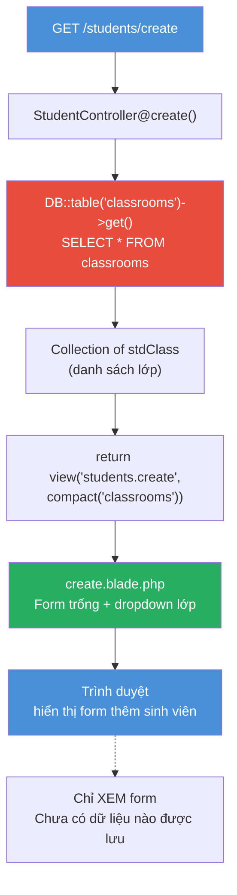

---

## Chức năng 4: Xử lý thêm sinh viên

| Thuộc tính            | Giá trị                                           |
| --------------------- | ------------------------------------------------- |
| **Mục đích**          | Nhận dữ liệu form, validate, lưu vào DB, redirect |
| **HTTP Method**       | POST                                              |
| **URL**               | `/students`                                       |
| **Route name**        | `students.store`                                  |
| **Controller method** | `StudentController@store(Request $request)`       |
| **Truy vấn DB**       | `DB::table('students')->insert([...])`            |
| **View**              | Không — redirect về `students.index`              |

### Phân tích code chi tiết

```php
// StudentController.php — dòng 34-55
public function store(Request $request)
{
    // BƯỚC 1: Validation THỰC SỰ (dòng 36-39)
    $request->validate([
        'StudentName'  => 'required',
        'StudentEmail' => 'required|email',
    ]);

    // BƯỚC 2: Lấy dữ liệu từ request (dòng 40-43)
    $StudentName   = $request->input('StudentName');
    $StudentEmail  = $request->input('StudentEmail');
    $StudentGender = $request->input('StudentGender');
    $ClassRoomID   = $request->input('ClassRoomID');

    // BƯỚC 3: ⚠️ Khai báo $validatedData nhưng KHÔNG DÙNG (dòng 44-47)
    $validatedData = ([         // Đây chỉ là mảng PHP thông thường, KHÔNG phải validation
        'StudentName'  => 'required',
        'StudentEmail' => 'required',
    ]);
    // $validatedData không được dùng ở bất kỳ đâu → vô dụng, gây nhầm lẫn!

    // BƯỚC 4: Insert vào DB bằng Query Builder (dòng 48-53)
    DB::table('students')->insert([
        'StudentName'   => $StudentName,
        'StudentEmail'  => $StudentEmail,
        'StudentGender' => $StudentGender,
        'ClassRoomID'   => $ClassRoomID,
    ]);

    // BƯỚC 5: Redirect kèm flash message (dòng 54)
    return redirect()->route('students.index')->with('success', 'Student created successfully.');
}
```

**Validation thực sự:** `$request->validate([...])` ở dòng 36-39. Nếu thất bại → tự động redirect về form, flash errors.

**`$validatedData` ở dòng 44-47:** KHÔNG phải validation — là lỗi code. Chỉ là gán mảng PHP vào biến, không sử dụng.

**PRG Pattern:** Dùng `redirect()` sau POST để tránh resubmit form khi người dùng nhấn F5.

### Sơ đồ luồng thêm sinh viên

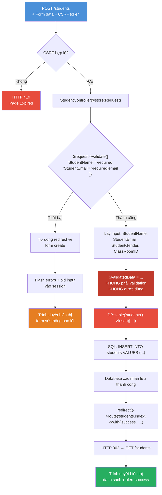

**Đọc sơ đồ:** POST request trải qua CSRF check → Validation → DB insert. Sau khi thành công, redirect tạo GET request mới. `$validatedData` được tô đỏ vì là lỗi code.

---

## Chức năng 5: Xem chi tiết sinh viên

| Thuộc tính            | Giá trị                                    |
| --------------------- | ------------------------------------------ |
| **Mục đích**          | Hiển thị thông tin chi tiết một sinh viên  |
| **HTTP Method**       | GET                                        |
| **URL**               | `/students/{student}` (VD: `/students/1`)  |
| **Route name**        | `students.show`                            |
| **Controller method** | `StudentController@show(Student $student)` |
| **Truy vấn DB**       | Tự động qua Route Model Binding            |
| **View**              | `resources/views/students/show.blade.php`  |

### Phân tích code

```php
// StudentController.php — dòng 60-63
public function show(Student $student)
//                   ↑ Laravel tự động inject Student object từ ID trên URL
{
    return view('students.show', compact('student'));
}
```

**Route Model Binding hoạt động thế nào?**

1. URL `/students/1` → tham số `{student}` = `1`.
2. Laravel nhìn vào type-hint `Student $student`.
3. Laravel thực thi: `Student::where('StudentID', 1)->firstOrFail()`.
4. Nếu tìm thấy → inject vào phương thức.
5. **Nếu không tìm thấy → tự động trả về HTTP 404**.

> **Lưu ý:** Vì `Student` khai báo `protected $primaryKey = 'StudentID'`, Model Binding dùng `StudentID` (không phải `id` mặc định).

**View `show.blade.php`** hiển thị: `StudentName`, `StudentEmail`, `StudentGender`.

> **Nhận xét:** View `show.blade.php` **không hiển thị tên lớp** của sinh viên — thiếu sót về thông tin.

### Sơ đồ luồng xem chi tiết

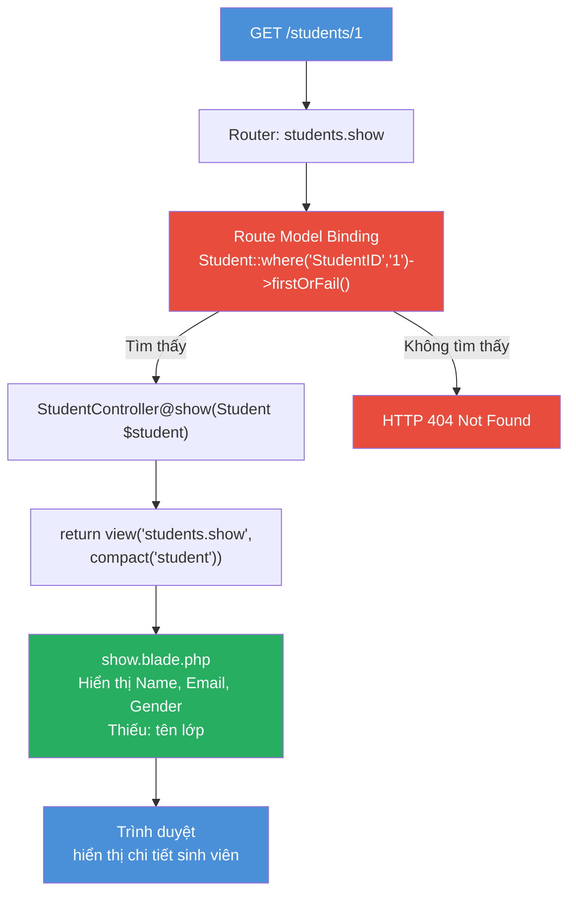

---

## Chức năng 6: Hiển thị biểu mẫu sửa sinh viên

| Thuộc tính            | Giá trị                                    |
| --------------------- | ------------------------------------------ |
| **Mục đích**          | Hiển thị form sửa, đã điền sẵn dữ liệu cũ  |
| **HTTP Method**       | GET                                        |
| **URL**               | `/students/{student}/edit`                 |
| **Route name**        | `students.edit`                            |
| **Controller method** | `StudentController@edit(Student $student)` |
| **Truy vấn DB**       | Route Model Binding + `Classroom::all()`   |
| **View**              | `resources/views/students/edit.blade.php`  |

### Phân tích code

```php
// StudentController.php — dòng 68-76
public function edit(Student $student)
{
    //$classrooms = DB::table('classrooms')->get();  // Đã comment out
    $classrooms = Classroom::all();                   // Dùng Eloquent (khác create())
    return view('students.edit', [
        'classrooms' => $classrooms,
        'student'    => $student
    ]);
}
```

#### View: Điền dữ liệu cũ vào form

```blade
{{-- old('StudentName', $default) --}}
{{-- Nếu validation thất bại → dùng old value; nếu mới mở → dùng giá trị từ DB --}}
<input type="text" name="StudentName"
       value="{{ old('StudentName', $student->StudentName) }}" required/>

{{-- Dropdown chọn đúng lớp hiện tại --}}
@foreach($classrooms as $classroom)
    <option value="{{ $classroom->ClassRoomID }}"
        @selected((string) old('ClassRoomID', $student->ClassRoomID) === (string) $classroom->ClassRoomID)>
        {{ $classroom->ClassRoomName }}
    </option>
@endforeach
```

### Sơ đồ luồng mở form sửa

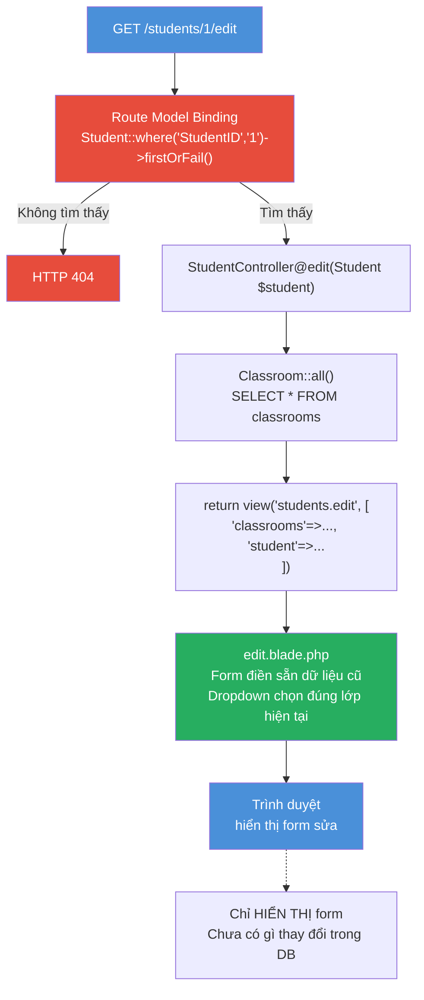

---

## Chức năng 7: Cập nhật sinh viên

| Thuộc tính            | Giá trị                                                        |
| --------------------- | -------------------------------------------------------------- |
| **Mục đích**          | Nhận dữ liệu form sửa, cập nhật DB, redirect                   |
| **HTTP Method**       | PUT (via POST + `@method('PUT')`)                              |
| **URL**               | `/students/{student}`                                          |
| **Route name**        | `students.update`                                              |
| **Controller method** | `StudentController@update(Request $request, Student $student)` |
| **Truy vấn DB**       | `$student->update([...])` — Eloquent                           |
| **View**              | Không trả về view — redirect                                   |

### Phân tích code

```php
// StudentController.php — dòng 81-101
public function update(Request $request, Student $student)
{
    $StudentName   = $request->input('StudentName');
    $StudentEmail  = $request->input('StudentEmail');
    $StudentGender = $request->input('StudentGender');
    $ClassRoomID   = $request->input('ClassRoomID');

    // ⚠️ SAI — $validatedData chỉ là mảng PHP, KHÔNG phải validation
    $validatedData = ([
        'StudentName'  => 'required',
        'StudentEmail' => 'required',
    ]);
    // → Dữ liệu KHÔNG được validate trước khi cập nhật!

    $student->update([
        'StudentName'   => $StudentName,
        'StudentEmail'  => $StudentEmail,
        'StudentGender' => $StudentGender,
        'ClassRoomID'   => $ClassRoomID,
    ]);

    return redirect()->route('students.index')
                     ->with('success', 'Student Data has been updated successfully.');
}
```

**`$student->update([...])` hoạt động thế nào?**

- `$student` đã được inject bởi Route Model Binding → là đúng bản ghi cần sửa.
- `update()` thực hiện: `UPDATE students SET StudentName=?, ... WHERE StudentID=?`.
- Chỉ cập nhật các cột có trong `$fillable`.

**Cơ sở dữ liệu thay đổi khi nào?** Khi `$student->update([...])` được gọi — ngay lập tức.

### Sơ đồ luồng cập nhật

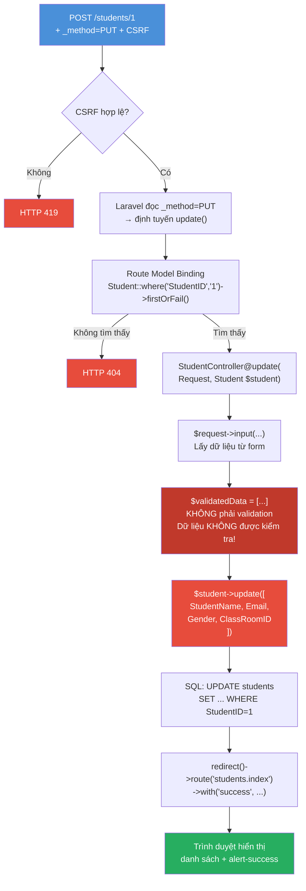

---

## Chức năng 8: Xóa sinh viên

| Thuộc tính            | Giá trị                                       |
| --------------------- | --------------------------------------------- |
| **Mục đích**          | Xóa một sinh viên khỏi DB                     |
| **HTTP Method**       | DELETE (via POST + `@method('DELETE')`)       |
| **URL**               | `/students/{student}`                         |
| **Route name**        | `students.destroy`                            |
| **Controller method** | `StudentController@destroy(Student $student)` |
| **Truy vấn DB**       | `$student->delete()` — Eloquent               |
| **View**              | Không trả về view — redirect                  |

### Phân tích code

```php
// StudentController.php — dòng 106-111
public function destroy(Student $student)
{
    //Bo sung xac nhan xoa   ← Comment gợi ý developer biết cần thêm xác nhận
    $student->delete();
    return redirect()->route('students.index')
                     ->with('success', 'Student Date deleted successfully.');
    //                                          ↑ Lỗi typo: "Date" thay vì "Data"
}
```

**Form xóa trong `index.blade.php`:**

```blade
<form method="post" action="{{ route('students.destroy', $row->StudentID) }}">
    @csrf
    @method('DELETE')
    <input type="submit" class="btn btn-danger btn-sm" value="Xóa"/>
</form>
```

> **Nhận xét:** Không có dialog xác nhận trước khi xóa. Nhấn "Xóa" là xóa ngay, không thể phục hồi.

> **CASCADE DELETE:** Nếu xóa một **lớp** → tất cả sinh viên của lớp đó bị xóa theo. Ngược lại, xóa **sinh viên** không ảnh hưởng đến bảng lớp.

### Sơ đồ luồng xóa

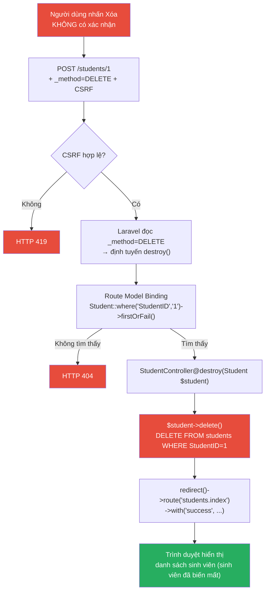

---

# PHẦN IV — TỔNG HỢP BẰNG SƠ ĐỒ

## Sơ đồ 1: Kiến trúc Laravel MVC tổng quát

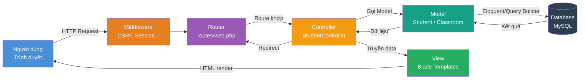

## Sơ đồ 2: Vòng đời HTTP Request/Response của Laravel 13

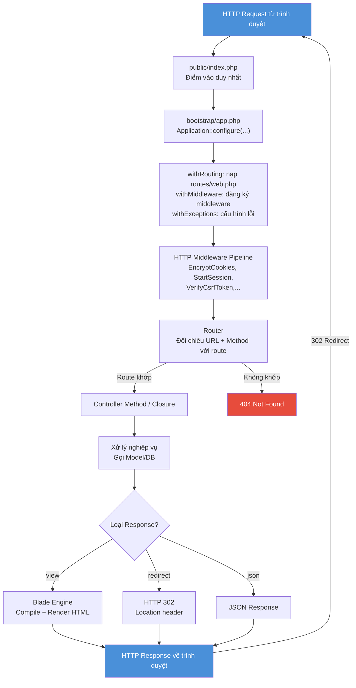

## Sơ đồ 3: Route → Controller → Model/DB → View

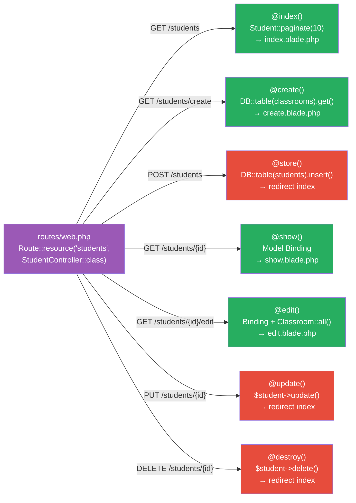

## Sơ đồ 12: Quan hệ dữ liệu Student–Classroom

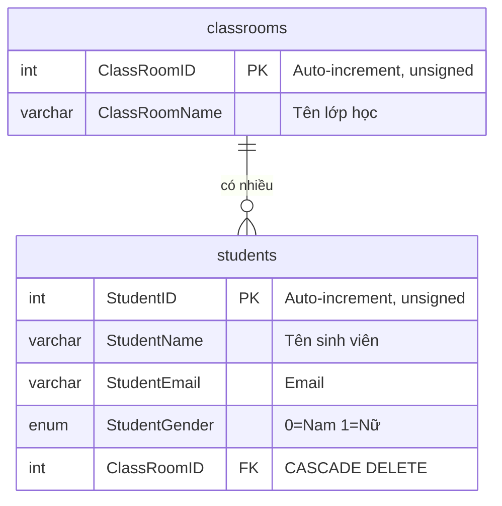

## Sơ đồ 13: Tổng quan toàn bộ dự án

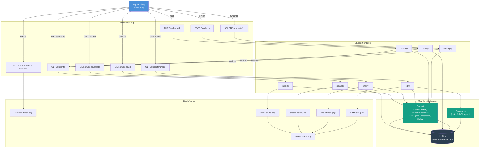

---

# PHẦN V — ĐỐI CHIẾU LÝ THUYẾT VỚI MÃ NGUỒN

## Bảng ánh xạ lý thuyết ↔ Code thực tế

| Kiến thức lý thuyết            | Thành phần trong dự án                              | Ví dụ code thực tế                                                                                 | Giải thích                                         |
| ------------------------------ | --------------------------------------------------- | -------------------------------------------------------------------------------------------------- | -------------------------------------------------- | ------------------------------------------------- |
| **Routing**                    | `routes/web.php`                                    | `Route::resource('students', StudentController::class)`                                            | Một dòng sinh ra 7 routes CRUD tiêu chuẩn          |
| **Controller**                 | `StudentController.php`                             | `public function index() { return view(...); }`                                                    | Điều phối: nhận request → gọi Model → gọi View     |
| **Model**                      | `app/Models/Student.php`                            | `class Student extends Model { ... }`                                                              | Đại diện bảng `students`, định nghĩa PK và quan hệ |
| **View**                       | `students/index.blade.php`                          | `@foreach($students as $row) {{ $row->StudentName }}`                                              | Render HTML từ dữ liệu được truyền từ Controller   |
| **Eloquent ORM**               | Trong `StudentController.php`                       | `Student::paginate(10)`, `$student->update([...])`, `$student->delete()`                           | Truy vấn DB bằng cú pháp PHP thay vì SQL           |
| **Query Builder**              | Trong `StudentController.php`                       | `DB::table('classrooms')->get()`, `DB::table('students')->insert([...])`                           | Fluent interface SQL, không qua Model class        |
| **Migration**                  | `database/migrations/..._create_students_table.php` | `$table->integerIncrements('StudentID')`                                                           | Định nghĩa cấu trúc bảng bằng code PHP             |
| **Foreign key**                | Migration students                                  | `$table->foreign('ClassRoomID')->references('ClassRoomID')->on('ClassRooms')->onDelete('cascade')` | Ràng buộc khóa ngoại, cascade xóa                  |
| **Validation**                 | `StudentController@store()` dòng 36-39              | `$request->validate(['StudentName'=>'required', 'StudentEmail'=>'required                          | email'])`                                          | Validation thực sự, tự động redirect nếu thất bại |
| **Redirect**                   | Sau store/update/destroy                            | `return redirect()->route('students.index')->with('success', '...')`                               | PRG Pattern sau thao tác ghi dữ liệu               |
| **Session flash message**      | Controller + index.blade.php                        | `->with('success', '...')` + `Session::get('success')`                                             | Thông báo 1 lần, bị xóa sau khi đọc                |
| **Route model binding**        | show/edit/update/destroy                            | `public function show(Student $student)`                                                           | Laravel tự inject Student object từ ID trên URL    |
| **Blade template inheritance** | master + index/create/edit/show                     | `@extends('students.master')` + `@section('content')` + `@yield('content')`                        | Tái sử dụng layout HTML, tránh lặp code            |

---

## 10 Câu hỏi đối chiếu lý thuyết

### Câu 1: Tại sao truy cập `/students` lại gọi được `StudentController@index`?

`Route::resource('students', StudentController::class)` tự động đăng ký route `GET /students → StudentController@index`. Router đối chiếu URL và method, gọi phương thức `index()`.

### Câu 2: Tại sao `return view(...)` có thể hiển thị dữ liệu từ cơ sở dữ liệu?

`return view('students.index', ['students' => Student::paginate(10)])` truyền biến `$students` đã chứa dữ liệu từ DB vào View. View nhận Collection và dùng `@foreach` để render HTML. View **không tự truy vấn** — dữ liệu đã được Controller chuẩn bị.

### Câu 3: Controller lấy dữ liệu từ Model rồi truyền sang View bằng cách nào?

```php
$students = Student::paginate(10);
return view('students.index', ['students' => $students]);  // mảng kết hợp
// hoặc compact()
return view('students.edit', compact('classrooms', 'student'));
```

Khóa của mảng (`'students'`) trở thành tên biến (`$students`) trong View.

### Câu 4: Tại sao `$student->update()` có thể cập nhật đúng một sinh viên?

`$student` được inject bởi Route Model Binding — Laravel đã tìm bản ghi có `StudentID` khớp với ID trên URL. `update()` biết chính xác cần UPDATE bản ghi nào.

SQL tương đương: `UPDATE students SET StudentName=?, ... WHERE StudentID=1`

### Câu 5: Laravel xác định bảng và khóa chính của `Student` như thế nào?

- **Tên bảng:** Tự suy ra là `students` (plural của `Student`).
- **Khóa chính:** Khai báo rõ `$primaryKey = 'StudentID'` (khác mặc định `id`).
- **Timestamps:** Tắt bằng `$timestamps = false` (bảng không có `created_at`, `updated_at`).

### Câu 6: `Student $student` được Laravel cung cấp như thế nào?

Route Model Binding: tham số `{student}` trong URL → Laravel gọi `Student::where('StudentID', id)->firstOrFail()` → inject vào phương thức. Không tìm thấy → 404.

### Câu 7: Tại sao khi thêm hoặc sửa dữ liệu thường có redirect?

PRG Pattern (Post-Redirect-Get): Nếu dùng `view()` sau POST, nhấn F5 → resubmit form → trùng dữ liệu. Redirect → trình duyệt gửi GET mới → F5 an toàn.

### Câu 8: Quan hệ Student–Classroom được khai báo ở đâu và dùng thế nào?

**Khai báo:** `Student.php` — `public function classroom() { return $this->belongsTo(Classroom::class, 'ClassRoomID', 'ClassRoomID'); }`

**Sử dụng:** `index.blade.php` — `{{ $row->classroom->ClassRoomName }}`

### Câu 9: Sự khác biệt giữa `DB::table('students')` và `Student::query()`?

`DB::table(...)` là Query Builder, trả về `stdClass`, không có quan hệ, không có mass assignment protection. `Student::query()` là Eloquent, trả về `Student` objects, có quan hệ, có `$fillable` bảo vệ.

### Câu 10: Nếu đổi tên route, tên bảng, tên khóa chính hoặc tên phương thức Controller?

| Thay đổi                       | Ảnh hưởng                                                                      |
| ------------------------------ | ------------------------------------------------------------------------------ |
| Đổi tên route                  | Tất cả `route('students.xxx')` trong View và Controller phải sửa               |
| Đổi URL                        | Sửa 1 chỗ trong `web.php` nếu dùng `route()`                                   |
| Đổi tên bảng                   | Thêm `protected $table = '...'` trong Model                                    |
| Đổi khóa chính                 | Sửa `$primaryKey` trong Model; tất cả code dùng `$student->StudentID` phải sửa |
| Đổi tên phương thức Controller | Sửa khai báo route tương ứng                                                   |

---

# PHẦN VI — NHẬN XÉT CODE VÀ CÁC ĐIỂM CẦN CHÚ Ý

## Vấn đề 1: `$validatedData` khai báo sai — Không có validation trong `update()`

**Vị trí:** `StudentController.php` — dòng 44-47 (store) và dòng 88-91 (update)

```php
// SAI — không phải validation!
$validatedData = ([
    'StudentName'  => 'required',
    'StudentEmail' => 'required',
]);
```

**Vấn đề:** Đây chỉ là gán mảng PHP vào biến. Validation thực sự phải là `$request->validate([...])`.

- Trong `store()`: có validation thực ở dòng 36-39 → `$validatedData` là thừa, gây nhầm lẫn.
- Trong `update()`: **không có validation nào cả** → người dùng có thể gửi dữ liệu rỗng hoặc không hợp lệ.

**Ảnh hưởng:** Dữ liệu không hợp lệ có thể được lưu vào database.

**Hướng cải thiện:**

```php
public function update(Request $request, Student $student) {
    $request->validate([
        'StudentName'  => 'required|string|max:255',
        'StudentEmail' => 'required|email|max:255',
        'StudentGender' => 'required|in:0,1',
        'ClassRoomID'  => 'required|exists:classrooms,ClassRoomID',
    ]);
    // ...
}
```

---

## Vấn đề 2: Không nhất quán giữa Eloquent ORM và Query Builder

**Vị trí:** `StudentController.php`

| Phương thức | Thao tác       | Cách dùng                                              |
| ----------- | -------------- | ------------------------------------------------------ |
| `create()`  | Lấy lớp học    | `DB::table('classrooms')->get()` (Query Builder)       |
| `store()`   | Thêm sinh viên | `DB::table('students')->insert([...])` (Query Builder) |
| `edit()`    | Lấy lớp học    | `Classroom::all()` (Eloquent)                          |
| `update()`  | Sửa sinh viên  | `$student->update([...])` (Eloquent)                   |

**Vấn đề:** Khó bảo trì. `store()` dùng Query Builder → không được bảo vệ bởi `$fillable`, không kích hoạt Eloquent events.

---

## Vấn đề 3: `Classroom` Model thiếu khai báo khóa chính và timestamps

**Vị trí:** `app/Models/Classroom.php`

```php
class Classroom extends Model {
    use HasFactory;
    // THIẾU: protected $primaryKey = 'ClassRoomID';
    // THIẾU: public $timestamps = false;
}
```

**Vấn đề:** `Classroom::find(1)` → Eloquent tìm `WHERE id = 1` → cột `id` không tồn tại → lỗi SQL. Hiện tại chưa xảy ra vì chỉ gọi `all()`, nhưng sẽ lỗi nếu mở rộng chức năng.

---

## Vấn đề 4: Tên bảng trong migration có thể gây lỗi case-sensitive

**Vị trí:** Migration students, dòng 20

```php
$table->foreign('ClassRoomID')->references('ClassRoomID')->on('ClassRooms')
//                                                              ↑ 'ClassRooms' chữ hoa R
```

Nhưng bảng được tạo tên là `classrooms` (chữ thường). Trên Linux (case-sensitive), đây là hai tên bảng khác nhau → migration có thể thất bại.

---

## Vấn đề 5: View `show.blade.php` thiếu thông tin tên lớp

**Vị trí:** `resources/views/students/show.blade.php`

View chỉ hiển thị `StudentName`, `StudentEmail`, `StudentGender`. **Không có `ClassRoomName`**. Trang chi tiết thiếu thông tin quan trọng so với trang danh sách.

---

## Vấn đề 6: Không có xác nhận trước khi xóa

**Vị trí:** `index.blade.php` + `StudentController@destroy()`

Comment trong code: `//Bo sung xac nhan xoa` — developer biết nhưng chưa làm. Nhấn "Xóa" là xóa ngay lập tức, không thể phục hồi.

**Hướng cải thiện:**

```blade
<input type="submit" value="Xóa"
       onclick="return confirm('Bạn có chắc muốn xóa sinh viên này không?')"/>
```

---

## Vấn đề 7: Thiếu validation cho `ClassRoomID` và `StudentGender`

**Vị trí:** `StudentController@store()` validation

```php
$request->validate([
    'StudentName'  => 'required',
    'StudentEmail' => 'required|email',
    // THIẾU: 'StudentGender' => 'required|in:0,1'
    // THIẾU: 'ClassRoomID'  => 'required|exists:classrooms,ClassRoomID'
]);
```

Gửi `ClassRoomID` không tồn tại → vi phạm FK → lỗi DB 500.

---

## Vấn đề 8: Lỗi typo trong flash message

**Vị trí:** `StudentController@destroy()` — dòng 110

```php
->with('success', 'Student Date deleted successfully.')
//                          ↑ "Date" — phải là "Data"
```

---

## Vấn đề 9: `DatabaseSeeder.php` tham chiếu các Seeder không tồn tại

```php
$this->call([
    DepartmentSeeder::class,    // Không tồn tại!
    PositionSeeder::class,      // Không tồn tại!
    EmployeeSeeder::class,      // Không tồn tại!
    RecruitmentSeeder::class,   // Không tồn tại!
    ContractSeeder::class,      // Không tồn tại!
    AttendanceSeeder::class,    // Không tồn tại!
]);
```

`StudentSeeder` tồn tại nhưng không được gọi ở đây. Chạy `php artisan db:seed` → lỗi class không tồn tại.

---

## Vấn đề 10: Trang chủ không có điều hướng đến module sinh viên

`welcome.blade.php` là template mặc định của Laravel, không có link đến `/students`. Người dùng phải gõ URL thủ công.

---

# PHẦN VII — TÀI LIỆU ÔN TẬP VÀ CHUẨN BỊ BẢO VỆ

## 1. Tóm tắt kiến thức — Bản ghi nhớ nhanh

### MVC trong 3 dòng

- **Model** = Dữ liệu + Tương tác DB (`Student.php`, `Classroom.php`)
- **View** = Giao diện HTML (`index.blade.php`, `create.blade.php`...)
- **Controller** = Điều phối luồng (`StudentController.php`)

### Luồng CRUD nhanh

| Action       | Method | URL                 | Controller | DB                            | Response        |
| ------------ | ------ | ------------------- | ---------- | ----------------------------- | --------------- |
| Xem DS       | GET    | /students           | index()    | Student::paginate(10)         | view(index)     |
| Mở form thêm | GET    | /students/create    | create()   | DB::table(classrooms)::get()  | view(create)    |
| Lưu mới      | POST   | /students           | store()    | DB::table(students)::insert() | redirect(index) |
| Xem chi tiết | GET    | /students/{id}      | show()     | Model Binding                 | view(show)      |
| Mở form sửa  | GET    | /students/{id}/edit | edit()     | Binding + Classroom::all()    | view(edit)      |
| Lưu sửa      | PUT    | /students/{id}      | update()   | $student->update()            | redirect(index) |
| Xóa          | DELETE | /students/{id}      | destroy()  | $student->delete()            | redirect(index) |

### Điểm nhớ đặc biệt

1. `@csrf` — bắt buộc trong mọi form POST/PUT/DELETE.
2. `@method('PUT')` / `@method('DELETE')` — vì HTML form chỉ có GET/POST.
3. Route Model Binding — `Student $student` → Laravel tự inject từ ID trên URL.
4. `$primaryKey = 'StudentID'` — phải khai báo vì khác mặc định `id`.
5. `$timestamps = false` — bảng không có `created_at`, `updated_at`.
6. PRG Pattern — sau POST/PUT/DELETE phải `redirect()`, không `view()`.
7. Flash message — `->with('success', '...')` + `Session::get('success')` trong View.
8. `$validatedData = ([...])` trong dự án này là SAI — không phải validation.

---

## 2. Bộ câu hỏi vấn đáp (20 câu)

**C1. MVC là viết tắt của những thành phần nào? Mỗi thành phần có trách nhiệm gì?**  
→ Model (dữ liệu/DB), View (giao diện HTML), Controller (điều phối luồng).

**C2. Route là gì? Tại sao cần khai báo route?**  
→ Bản đồ URL+Method → code xử lý. Không có route → 404.

**C3. `Route::resource()` sinh ra bao nhiêu route? Kể tên.**  
→ 7 route: index, create, store, show, edit, update, destroy.

**C4. Middleware là gì? Dự án này có middleware xác thực đăng nhập không?**  
→ Lớp xử lý giữa request và Controller. Dự án này KHÔNG có — `withMiddleware` để trống.

**C5. Eloquent ORM là gì? Phân biệt với Query Builder.**  
→ Eloquent: class Model, quan hệ, fillable. QB: DB::table(), stdClass, không có bảo vệ.

**C6. `@csrf` có vai trò gì? Điều gì xảy ra nếu thiếu?**  
→ Ngăn CSRF attack. Thiếu → HTTP 419.

**C7. `@method('PUT')` và `@method('DELETE')` dùng để làm gì?**  
→ HTML form chỉ có GET/POST. Hidden input `_method` để Laravel nhận diện PUT/DELETE.

**C8. Blade Template Inheritance là gì? Giải thích `@extends`, `@section`, `@yield`.**  
→ `master.blade.php` dùng `@yield` đánh dấu vùng trống. View con `@extends` kế thừa, `@section` điền vào.

**C9. `Student::paginate(10)` làm gì? Khác `Student::all()` ở điểm nào?**  
→ paginate: 10 bản ghi/trang, đọc `?page=N`. all: lấy tất cả — kém hiệu năng khi data lớn.

**C10. Route Model Binding hoạt động thế nào? Điều gì xảy ra nếu không tìm thấy bản ghi?**  
→ Type-hint `Student $student` → Laravel tìm `where('StudentID', id)->firstOrFail()`. Không có → 404.

**C11. Giải thích:** `return view('students.index', ['students' => Student::paginate(10)]);`  
→ paginate truy vấn DB, mảng truyền biến $students vào View, View render HTML.

**C12. Giải thích:** `$this->belongsTo(Classroom::class, 'ClassRoomID', 'ClassRoomID')`  
→ Một sinh viên thuộc về một lớp. FK là ClassRoomID trong students, PK là ClassRoomID trong classrooms.

**C13. `$validatedData = ([...])` trong `update()` có thực hiện validation không?**  
→ **KHÔNG.** Chỉ là gán mảng PHP. Validation thực phải dùng `$request->validate([...])`.

**C14. Tại sao dùng `{!! $students->links() !!}` thay vì `{{ }}`?**  
→ `{{ }}` escape HTML → phá vỡ HTML phân trang. `{!! !!}` xuất HTML nguyên vẹn.

**C15. Khi validation thất bại trong `store()`, người dùng thấy gì?**  
→ Redirect về form create, hiển thị lỗi qua `$errors->all()`, dữ liệu cũ giữ qua `old()`.

**C16. N+1 Problem là gì trong trang danh sách?**  
→ 10 sinh viên → 1 truy vấn DS + 10 truy vấn lấy lớp = 11 truy vấn. Sửa bằng `with('classroom')`.

**C17. Phân biệt `return view()` và `return redirect()->route()`.**  
→ view(): render HTML ngay. redirect(): HTTP 302, trình duyệt gửi GET mới. Dùng redirect sau POST để tránh resubmit.

**C18. `$fillable` trong Model bảo vệ điều gì?**  
→ Ngăn mass assignment vulnerability. Chỉ cột trong $fillable mới được ghi qua create()/update(). DB::table()->insert() không có bảo vệ này.

**C19. Migration và Seeder khác nhau như thế nào?**  
→ Migration: cấu trúc bảng. Seeder: dữ liệu mẫu. Dự án: StudentSeeder chèn 5 sinh viên, nhưng DatabaseSeeder không gọi nó.

**C20. Nếu `ClassRoomID` trong form gửi lên không tồn tại trong bảng classrooms, điều gì xảy ra?**  
→ Vi phạm Foreign Key → lỗi SQL → HTTP 500. Sửa bằng validate `exists:classrooms,ClassRoomID`.

---

## 3. Bài tập tự kiểm tra

### Tình huống 1: Đổi URL danh sách

> Đổi `/students` thành `/sinhvien` (URL hiển thị trên trình duyệt).

**Câu hỏi:** Bạn cần sửa những file nào và tại sao?

---

### Tình huống 2: Thêm trường `StudentPhone`

> Thêm số điện thoại vào thông tin sinh viên.

**Câu hỏi:** Bạn cần sửa những file nào theo thứ tự nào?

---

### Tình huống 3: Đổi khóa chính từ `StudentID` sang `id`

> Chuẩn hóa tên khóa chính về quy ước Laravel mặc định.

**Câu hỏi:** Những file nào bị ảnh hưởng? Route Model Binding có ảnh hưởng không?

---

### Tình huống 4: Thêm validation email không trùng

> Kiểm tra email chưa tồn tại trong database trước khi thêm.

**Câu hỏi:** Cần sửa file nào? Viết rule validation.

---

### Tình huống 5: Đổi Lazy Loading sang Eager Loading

> Giảm số lượng truy vấn SQL khi hiển thị danh sách.

**Câu hỏi:** Cần sửa file nào? Code thay đổi như thế nào?

---

## ĐÁP ÁN THAM KHẢO

### Đáp án 1: Đổi URL

Sửa `routes/web.php`: đổi `students` → `sinhvien` trong `Route::resource`. Nếu tên route cũng đổi theo (→ `sinhvien.index`), phải sửa tất cả `route('students.xxx')` trong các View và Controller.

### Đáp án 2: Thêm `StudentPhone`

Thứ tự: **Migration → Model → Controller → Views**

1. Tạo migration mới, thêm cột `StudentPhone`.
2. `Student.php`: Thêm `'StudentPhone'` vào `$fillable`.
3. `StudentController.php`: Thêm input trong `store()` và `update()`, thêm validation.
4. `create.blade.php`, `edit.blade.php`: Thêm input field.
5. `index.blade.php`, `show.blade.php`: Thêm cột hiển thị (nếu cần).

### Đáp án 3: Đổi khóa chính

Files cần sửa: Migration (đổi `integerIncrements('StudentID')` → `id()`), `Student.php` (xóa `$primaryKey` và xóa `StudentID` khỏi `$fillable`), tất cả Views dùng `$student->StudentID` → `$student->id`, Migration students (cột FK). Route Model Binding vẫn hoạt động — sẽ tự dùng cột `id` mới.

### Đáp án 4: Validation email không trùng

Sửa `StudentController@store()`:

```php
'StudentEmail' => 'required|email|unique:students,StudentEmail',
```

Sửa `StudentController@update()`:

```php
'StudentEmail' => 'required|email|unique:students,StudentEmail,' . $student->StudentID . ',StudentID',
```

Không cần sửa View vì `$errors` tự hiển thị.

### Đáp án 5: Eager Loading

Sửa `StudentController@index()`:

```php
// Trước:
Student::paginate(10)
// Sau:
Student::with('classroom')->paginate(10)
```

Không cần sửa View. `$row->classroom->ClassRoomName` vẫn hoạt động nhưng không gửi thêm truy vấn vì đã được load sẵn.

---

## Checklist Tự Kiểm Tra Trước Bảo Vệ

- [ ] Giải thích được MVC và vai trò từng thành phần
- [ ] Vẽ được luồng xử lý từ request đến response
- [ ] Giải thích được `Route::resource()` sinh ra bao nhiêu route
- [ ] Biết tại sao `@csrf` và `@method()` cần thiết
- [ ] Giải thích được Route Model Binding
- [ ] Phân biệt được Eloquent ORM và Query Builder
- [ ] Giải thích được `$fillable`, `$primaryKey`, `$timestamps`
- [ ] Giải thích được quan hệ `belongsTo()`
- [ ] Biết tại sao dùng `redirect()` sau POST/PUT/DELETE
- [ ] Giải thích được cách flash message hoạt động
- [ ] Nhận ra `$validatedData = ([...])` là SAI — không phải validation
- [ ] Giải thích được N+1 problem và cách sửa bằng Eager Loading
- [ ] Biết cấu trúc thư mục dự án và vai trò từng file

---

_Tài liệu được tạo từ phân tích mã nguồn thực tế của dự án **projectQLSV** (Laravel 13.x)._  
_Mọi giải thích được đối chiếu trực tiếp với code trong thư mục dự án._  
_Không tự ý sửa bất kỳ file nào trong dự án._
